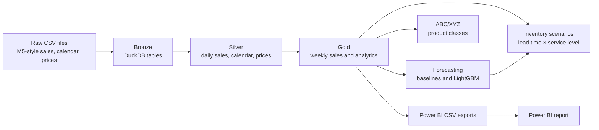

# Retail Demand Forecasting and Optimization

A retail analytics project with code to turn daily sales, calendar, and price
data into weekly demand forecasts, product classifications, inventory policy
scenarios, and Power BI reporting. The Python pipeline uses a
Bronze/Silver/Gold data architecture and DuckDB/Parquet for data processing.

This repository contains the analysis code and scripts that generate its
scenario outputs. It does not claim that forecast metrics translate directly
into savings, fewer stockouts, or other realized business outcomes.

## Business problem and objectives

Retail teams need to understand sales patterns at product and store level,
compare demand forecasts, identify products with different revenue and
variability profiles, and examine how lead time and service-level assumptions
change reorder policies.

The project aims to:

- Preserve source data in a queryable Bronze layer and prepare reusable Silver
  and Gold datasets.
- Compare simple forecasting baselines with LightGBM using a chronological
  28-week holdout.
- Classify products by estimated revenue contribution (ABC) and weekly demand
  variability (XYZ).
- Explore reorder-point and safety-stock scenarios across selected lead times
  and target service levels.
- Present sales, forecast, and product views in Power BI.

## Architecture



## Pipeline and methods

### Bronze: ingest and validate

- [`src/ingestion/build_bronze.py`](src/ingestion/build_bronze.py) loads the
  calendar, sales validation/evaluation, sample submission, and sell-price CSVs
  into DuckDB tables in `data/bronze/retail_bronze.duckdb`.
- [`src/ingestion/validate_bronze.py`](src/ingestion/validate_bronze.py) checks
  calendar and sales keys, duplicate price keys, price quality, and submission
  IDs.

The ingestion script reads five CSVs from the directory configured in its
`DATASET` constant. That constant currently contains a machine-specific
absolute Windows path; update it to the directory containing the source CSVs
before running the pipeline on another machine. Raw competition data is not
included in this repository.

### Silver: daily sales and dimensions

- [`src/transformation/build_silver_sales.py`](src/transformation/build_silver_sales.py)
  unpivots the wide `bronze_sales_evaluation` table into one row per
  product/store/date and joins the day key to the Bronze calendar.
- The result is
  `data/processed/silver/sales_daily.parquet`, a daily long-format dataset with
  product, department, category, store, state, date, day key, and sales units.
- [`src/transformation/build_silver_dimensions.py`](src/transformation/build_silver_dimensions.py)
  writes typed calendar and sell-price Parquet files.
- [`src/transformation/build_silver_enriched.py`](src/transformation/build_silver_enriched.py)
  joins daily sales to calendar attributes and weekly sell prices.

The sales transformation uses the evaluation sales table. The validation sales
table is ingested and checked in Bronze, but is not used by this transformation.

### Gold: forecasting base and analytics

- [`src/forecasting/build_weekly_forecasting_base.py`](src/forecasting/build_weekly_forecasting_base.py)
  aggregates Silver daily units to product/store/week in
  `data/processed/gold/weekly_forecasting_base.parquet`.
- [`src/analytics/build_gold_sales.py`](src/analytics/build_gold_sales.py)
  uses enriched Silver data to create weekly item/store sales and revenue,
  monthly store/category performance, and store summaries.
- [`src/analytics/build_abc_xyz.py`](src/analytics/build_abc_xyz.py) calculates
  product-level estimated revenue and demand variability from weekly
  item/store data.
- [`src/analytics/build_monthly_demand_trends.py`](src/analytics/build_monthly_demand_trends.py),
  `build_monthly_seasonality.py`, and `build_top_products.py` create additional
  Gold analysis tables.

#### ABC/XYZ classes

ABC classes rank products by estimated revenue contribution: A covers the
leading 80% of cumulative revenue, B the next 15% (through 95%), and C the
remainder. The implementation uses cumulative revenue before each item when
assigning those bands.

XYZ classes use the coefficient of variation of weekly units
(`population standard deviation / mean weekly units`):

- X: CV at or below 0.50
- Y: CV above 0.50 and at or below 1.00
- Z: CV above 1.00
- N: mean weekly demand is not positive

Revenue is estimated from sales units multiplied by sell price; it is not a
profit or margin measure.

### Forecasting

The forecasting scripts are:

- [`src/forecasting/build_baseline_forecasts.py`](src/forecasting/build_baseline_forecasts.py):
  naive and 52-week seasonal-naive forecasts.
- [`src/forecasting/build_moving_average_forecasts.py`](src/forecasting/build_moving_average_forecasts.py):
  4-week and 13-week moving-average forecasts.
- [`src/forecasting/build_lgbm_features.py`](src/forecasting/build_lgbm_features.py):
  lag, rolling, and calendar features.
- [`src/forecasting/train_lightgbm.py`](src/forecasting/train_lightgbm.py):
  LightGBM training, holdout forecasts, and metrics.
- [`src/forecasting/build_model_comparison.py`](src/forecasting/build_model_comparison.py):
  overall and category-level model comparison.

The feature set includes lags of 1, 2, 3, 4, 8, 13, 26, and 52 weeks; 4- and
13-week rolling means; a 4-week rolling standard deviation; calendar fields;
and product/store hierarchy categories. Rolling windows stop before the target
week.

The last 28 weeks are held out chronologically. LightGBM is trained on rows
earlier than that window with a deterministic hash-selected training sample and
non-null 52-week lag. This is a rolling one-week-ahead evaluation: features for
a forecast week use preceding observed weeks, including earlier weeks in the
holdout once they have elapsed. It is not a single forecast issued once at the
start of the 28-week window.

### Inventory scenario analysis

[`src/inventory/build_inventory_scenarios.py`](src/inventory/build_inventory_scenarios.py)
creates nine combinations of lead time (1, 2, or 4 weeks) and target service
level (90%, 95%, or 99%) for each product/store series. It combines the latest
LightGBM weekly forecast with historical demand variability before the holdout
start to calculate lead-time demand, safety stock, and a rounded-up reorder
point. [`src/inventory/build_inventory_sensitivity.py`](src/inventory/build_inventory_sensitivity.py)
summarizes the policies and compares the 1-week/90% case with the 4-week/99%
case.

This is **inventory scenario analysis**, not a full inventory optimization
engine. It does not model inventory on hand, replenishment decisions, supplier
constraints, ordering costs, or realized stockout outcomes.

## Verified forecast results

The current local Parquet outputs were verified during this handoff, and the
script definitions confirm the metric formulas. WAPE is
`100 × sum(abs(actual - forecast)) / sum(actual)` and is reported as a
percentage; lower is better. MAE is the average absolute forecast error in
weekly units per evaluated product/store forecast.

| Model | WAPE | MAE |
|---|---:|---:|
| LightGBM | 36.040774% | 3.334665 units |
| Seasonal naive (52-week) | 64.244663% | Not listed here |
| Naive | 41.619896% | Not listed here |

The metric outputs are
`data/outputs/forecasting/lightgbm_model_metrics.parquet` and
`data/outputs/forecasting/model_comparison.parquet`. Those generated files are
ignored by Git, so the values above describe the verified local run and are not
recreated merely by cloning the repository. These metrics alone do not establish
business savings, improved availability, or stockout reduction.

## Power BI report

The PBIX file contains these three named report pages:

1. **Executive Overview** — sales KPIs, category comparisons, monthly trends,
   and slicers.
2. **Forecast Performance** — actual-versus-forecast views, model WAPE
   comparison, forecast metrics, and weekly data.
3. **Product Intelligence** — top products by revenue and units, ABC/XYZ
   analysis, and demand variability.

Open the PBIX in Power BI Desktop:

- `dashboard/retail-demand-optimization.pbix.pbix`

The editable PBIP project is also present:

- `dashboard/retail-demand-optimization.pbip`
- `dashboard/retail-demand-optimization.Report/`
- `dashboard/retail-demand-optimization.SemanticModel/`

**PBIP/PBIX consistency needs attention:** the PBIX contains the three pages
above, but the PBIP report definition currently lists only one generic
`Page 1`. Its semantic model currently contains two imported business tables,
`monthly_demand_trends` and `category_sales`, plus Power BI date tables. The
PBIP's Power Query definitions point to absolute CSV paths under the original
developer's `C:\Users\vivek\...` directory. No dashboard changes were made as
part of this documentation work.

The PBIP report data is read from:

- `data/outputs/powerbi/monthly_demand_trends.csv`
- `data/outputs/powerbi/category_sales.csv`

These are generated by `src/analytics/export_powerbi_monthly_trends.py` and
`src/analytics/export_powerbi_category_sales.py`, respectively. Recreate them
after their Gold inputs are ready, then update the two Power Query file paths
in Power BI Desktop if the project is in a different directory. The
`data/outputs/powerbi/dashboard_data/` folder also contains generated CSVs, but
the checked PBIP semantic model does not currently reference those files.

No dashboard screenshot images were found in the repository. After opening the
PBIX, capture each page in Power BI Desktop and save the images to
`docs/screenshots/` using these names:

- `executive-overview.png`
- `forecast-performance.png`
- `product-intelligence.png`

No placeholder screenshots are included.

## Technology stack

The declared Python dependencies in [`requirements.txt`](requirements.txt) are
DuckDB, PyArrow, pandas, NumPy, SQLAlchemy, psycopg, scikit-learn, matplotlib,
seaborn, JupyterLab, openpyxl, LightGBM, Streamlit, and Plotly. The pipeline
scripts directly use DuckDB, pandas, NumPy, and LightGBM; the full requirements
file also includes additional analysis and application packages.

## Repository layout and outputs

```text
.
├── dashboard/                  # PBIP report/model and PBIX report
├── data/
│   ├── raw/                    # source_inventory.csv; raw source CSVs are external
│   ├── bronze/                 # generated DuckDB database
│   ├── processed/
│   │   ├── silver/             # daily sales, calendar, prices, enriched sales
│   │   └── gold/               # weekly base, classifications, scenarios, trends
│   └── outputs/
│       ├── forecasting/        # forecasts and evaluation Parquet
│       └── powerbi/            # report-source and other generated CSVs
├── src/
│   ├── ingestion/
│   ├── transformation/
│   ├── analytics/
│   ├── forecasting/
│   └── inventory/
├── requirements.txt
└── README.md
```

Important generated outputs include:

- `data/processed/silver/sales_daily.parquet`
- `data/processed/gold/weekly_forecasting_base.parquet`
- `data/processed/gold/weekly_model_features.parquet`
- `data/processed/gold/product_abc_xyz.parquet`
- `data/processed/gold/inventory_scenario_summary.parquet`
- `data/processed/gold/inventory_sensitivity.parquet`
- `data/outputs/forecasting/lightgbm_model_metrics.parquet`
- `data/outputs/forecasting/model_comparison.parquet`
- `data/outputs/powerbi/monthly_demand_trends.csv`
- `data/outputs/powerbi/category_sales.csv`

Raw source data, the DuckDB database, generated Parquet, and generated output
files are excluded by `.gitignore`. The M5-style input CSVs are expected to be
available locally; they are not vendored here.

## Windows setup

Run these commands in PowerShell from the repository root:

```powershell
py -m venv .venv
.\.venv\Scripts\Activate.ps1
python -m pip install --upgrade pip
python -m pip install -r requirements.txt
```

If PowerShell blocks activation under the current policy, use the environment's
Python executable directly instead:

```powershell
.\.venv\Scripts\python.exe -m pip install -r requirements.txt
```

Before ingestion, edit the `DATASET` path in
`src/ingestion/build_bronze.py` to point to the directory containing
`calendar.csv`, `sales_train_validation.csv`, `sales_train_evaluation.csv`,
`sample_submission.csv`, and `sell_prices.csv`. Keep those raw files outside
Git.

## Run order

Run commands from the repository root after setup and after configuring the
source CSV path. Each stage consumes files generated by earlier stages.

```powershell
# Bronze
python src\ingestion\build_bronze.py
python src\ingestion\validate_bronze.py

# Silver
python src\transformation\build_silver_sales.py
python src\transformation\build_silver_dimensions.py
python src\transformation\validate_silver_sales.py
python src\transformation\validate_silver_dimensions.py
python src\transformation\build_silver_enriched.py
python src\transformation\validate_silver_enriched.py

# Gold sales and analytics
python src\analytics\build_gold_sales.py
python src\analytics\build_monthly_demand_trends.py
python src\analytics\build_abc_xyz.py
python src\analytics\build_monthly_seasonality.py
python src\analytics\build_top_products.py

# Forecasting
python src\forecasting\build_weekly_forecasting_base.py
python src\forecasting\build_baseline_forecasts.py
python src\forecasting\build_moving_average_forecasts.py
python src\forecasting\build_lgbm_features.py
python src\forecasting\train_lightgbm.py
python src\forecasting\build_model_comparison.py

# Inventory scenarios (uses the LightGBM forecast)
python src\inventory\build_inventory_scenarios.py
python src\inventory\build_inventory_sensitivity.py

# CSVs used by the current PBIP semantic model
python src\analytics\export_powerbi_monthly_trends.py
python src\analytics\export_powerbi_category_sales.py
```

The repository also includes standalone `validate_*.py` scripts under
`src/ingestion/`, `src/transformation/`, `src/analytics/`,
`src/forecasting/`, and `src/inventory/`. Run the validator for a stage after
its outputs have been generated.

## Validation and limitations

- The `tests/` directory is empty; no automated pytest or unittest suite was
  found during this inspection.
- Validation is currently provided by the standalone scripts named
  `validate_*.py`. All 16 existing validation scripts passed against the
  current generated outputs during this handoff. A fresh end-to-end rebuild was
  not run.
- Source discovery is not portable until the hardcoded `DATASET` path in
  `build_bronze.py` is updated for the local machine.
- PBIP data queries also contain absolute paths and need to be repointed after
  moving the project. The PBIP page/model definitions do not currently match
  the three-page PBIX file.
- The reported holdout metrics are forecast-evaluation measures, not measured
  operational outcomes.
- Inventory outputs compare assumed policies; they are not a cost-optimized
  replenishment plan.

Possible next steps include parameterizing local data paths, aligning the PBIP
report/model with the three-page PBIX, adding automated tests for core metric
and transformation logic, and extending inventory analysis with actual stock,
cost, and replenishment constraints.
